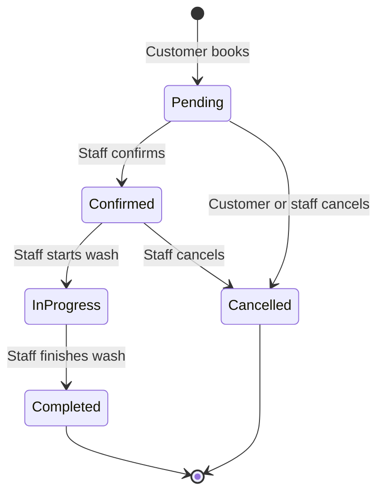
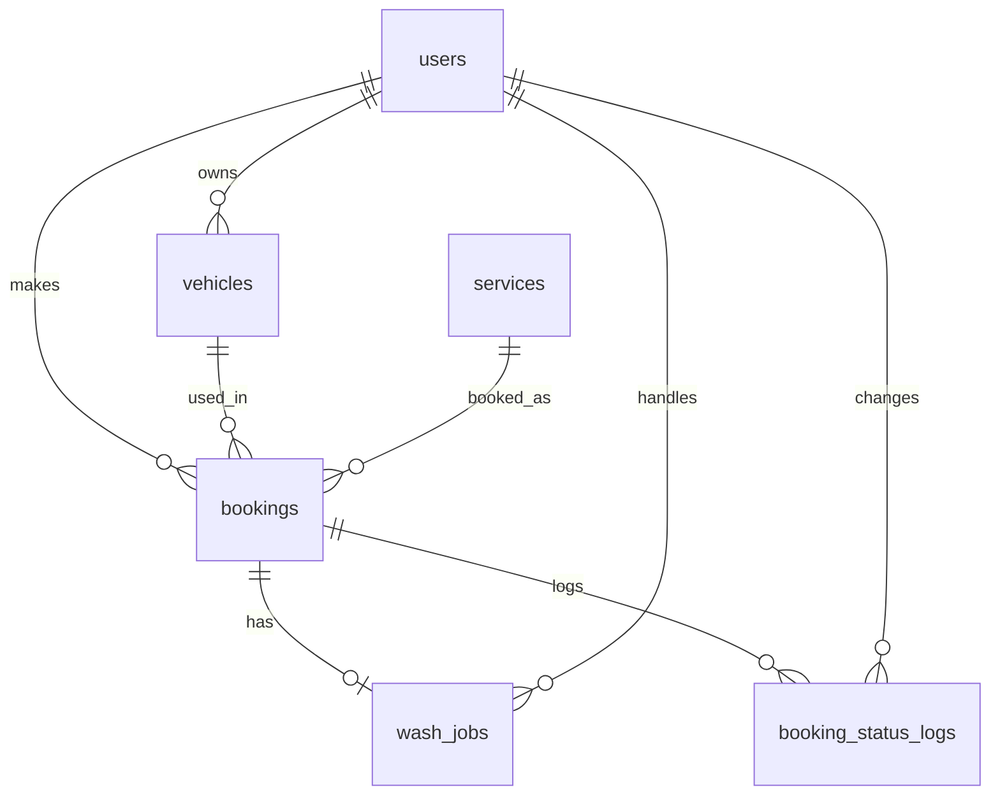

# PRD: Bara Cuci Kinclong – Car Wash Booking App

Version 1.0 · UAS project · Stack: Laravel + Filament, MySQL, XAMPP (Windows)

## 1. Problem and Goals

**Problem.** The car wash takes bookings by chat and phone. Staff track jobs on paper, so it is hard to see who is waiting, who is being washed, and how many jobs were done.

**Goals**
- Customers book a service, vehicle, date and time online.
- Staff confirm, start, finish, or cancel each booking.
- Admin sees a dashboard and 3 reports.

**Non-goals.** Payment, invoice, loyalty, vouchers, inventory, payroll, mobile app. Prices are shown as information only.

**Assumptions**
- Assumption: one booking = one service for one vehicle.
- Assumption: one user has one role.
- Assumption: max 3 bookings per time slot (set in config) to prevent overbooking.
- Assumption: opening hours 08:00–17:00, slots every hour.
- Assumption: a booking can be cancelled only before the wash starts.

## 2. User Roles

| Action | Customer | Staff | Admin |
|---|---|---|---|
| Register / login (email or Google) | ✔ | ✔ | ✔ |
| View service list | ✔ | ✔ | ✔ |
| Create booking, manage own vehicles | ✔ | – | ✔ |
| View own bookings | ✔ | – | – |
| Cancel own booking (while Pending) | ✔ | – | – |
| Confirm / start / finish / cancel any booking | – | ✔ | ✔ |
| View dashboard | – | ✔ | ✔ |
| View reports | – | – | ✔ |
| Manage services and users | – | – | ✔ |

## 3. User Stories

| # | Story | Acceptance criteria |
|---|---|---|
| 1 | As a customer, I log in with email or Google. | Wrong password shows a generic error. Google login creates a Customer account on first use. |
| 2 | As a customer, I see active services with prices. | Inactive services are hidden. Price and duration are shown. |
| 3 | As a customer, I save my vehicle. | Plate, type, brand required. Plate is unique per user. |
| 4 | As a customer, I book a service, vehicle, date, time. | Past dates and full slots are rejected. Booking starts as Pending. |
| 5 | As a customer, I see my bookings and status. | Only my bookings are listed, newest first. |
| 6 | As a customer, I cancel a Pending booking. | Status becomes Cancelled. Other statuses cannot be cancelled by me. |
| 7 | As staff, I confirm a booking. | Pending → Confirmed. A wash job (Waiting) is created. |
| 8 | As staff, I start a wash. | Confirmed → In Progress. Start time and staff are saved. |
| 9 | As staff, I finish a wash. | In Progress → Completed. Finish time is saved. |
| 10 | As admin, I view dashboard and reports. | Numbers match booking data. Reports filter by date. |

(Staff cancel: Pending or Confirmed → Cancelled, with a reason.)

## 4. Main Features

**Login.** Breeze (Livewire) for email login; Socialite for Google. Roles via `users.role`. Staff and Admin go to `/admin` (Filament). Customers go to `/home`.

**Services.** Admin manages name, description, price, duration, active flag.

**Booking.** Customer picks service, vehicle, date, time. System copies `service_price` and `duration_minutes` onto the booking.

**Wash process.** Staff actions in Filament: Confirm, Start, Finish, Cancel. Every change writes a status log row and updates both booking and wash job in one DB transaction.

**Dashboard / Reports.** See sections 5 and 6.

### Status flow

Wash job status: `waiting` (on confirm) → `in_progress` → `done`.

## 5. Dashboard (Staff and Admin)

| Widget | Definition |
|---|---|
| Bookings today | Count of bookings with today's date, excluding Cancelled |
| Pending confirmation | Count of Pending bookings |
| Active washes | Count of wash jobs `in_progress` |
| Completed this month | Count of Completed bookings in current month |
| Estimated revenue | Sum of `service_price` of Completed bookings this month (information only) |

## 6. Reports (Admin)

| Report | Columns | Filters |
|---|---|---|
| Bookings by period | Date, Total, Pending, Confirmed, Completed, Cancelled | Date range, group by day / month |
| Services by popularity | Service, Bookings, Completed, Estimated revenue | Date range, status |
| Wash status summary | Status, Count, Avg duration (min), Staff | Date range, staff |

Assumption: reports are Filament pages with a table and CSV export. Revenue uses stored `service_price`.

## 7. Filament Plan

**Resources**
- `ServiceResource` (Admin: full CRUD)
- `BookingResource` (table, filters, row actions: Confirm, Start, Finish, Cancel)
- `WashJobResource` (read-only list for staff to see queue)
- `UserResource` (Admin: manage staff and roles)
- `VehicleResource` (Admin: read-only)

**Widgets**
- `BookingStatsOverview` (4 stat cards: bookings today, pending, active washes, completed this month)
- `RevenueStat` (estimated revenue)
- `BookingsChart` (optional: last 7 days, line chart)

**Pages**
- `Dashboard` (default, holds widgets)
- `BookingsByPeriodReport`
- `ServicePopularityReport`
- `WashStatusReport`

**Access.** `canAccessPanel()` allows Staff and Admin only. Report pages and `UserResource`/`ServiceResource` are Admin only (policies).

**Customer pages (Livewire, outside Filament):** `/services`, `/vehicles`, `/book`, `/my-bookings`.

## 8. Database Schema

### users
| Column | Type | Notes |
|---|---|---|
| id | BIGINT UNSIGNED | PK |
| name | VARCHAR(100) | |
| email | VARCHAR(255) | unique |
| password | VARCHAR(255) | nullable (Google users) |
| google_id | VARCHAR(100) | nullable, unique |
| phone | VARCHAR(20) | nullable |
| role | ENUM('customer','staff','admin') | default 'customer' |
| created_at, updated_at | TIMESTAMP | |

### services
| Column | Type | Notes |
|---|---|---|
| id | BIGINT UNSIGNED | PK |
| name | VARCHAR(100) | |
| description | TEXT | nullable |
| price | DECIMAL(12,2) | info only |
| duration_minutes | SMALLINT UNSIGNED | |
| is_active | BOOLEAN | default true |
| created_at, updated_at | TIMESTAMP | |

### vehicles
| Column | Type | Notes |
|---|---|---|
| id | BIGINT UNSIGNED | PK |
| user_id | BIGINT UNSIGNED | **FK → users.id** |
| plate_number | VARCHAR(15) | unique with user_id |
| type | ENUM('car','motorcycle','suv','other') | |
| brand | VARCHAR(50) | |
| model | VARCHAR(50) | nullable |
| created_at, updated_at | TIMESTAMP | |

### bookings
| Column | Type | Notes |
|---|---|---|
| id | BIGINT UNSIGNED | PK |
| code | VARCHAR(25) | unique, e.g. BKG-20261023-0001 |
| user_id | BIGINT UNSIGNED | **FK → users.id** |
| vehicle_id | BIGINT UNSIGNED | **FK → vehicles.id** |
| service_id | BIGINT UNSIGNED | **FK → services.id** |
| service_price | DECIMAL(12,2) | copied from service at booking |
| duration_minutes | SMALLINT UNSIGNED | copied from service |
| booking_date | DATE | |
| start_time | TIME | |
| status | ENUM('pending','confirmed','in_progress','completed','cancelled') | default 'pending' |
| cancel_reason | VARCHAR(255) | nullable |
| notes | VARCHAR(255) | nullable |
| created_at, updated_at | TIMESTAMP | |

Index: (`booking_date`, `status`).

### wash_jobs
| Column | Type | Notes |
|---|---|---|
| id | BIGINT UNSIGNED | PK |
| booking_id | BIGINT UNSIGNED | **FK → bookings.id**, unique |
| staff_id | BIGINT UNSIGNED | **FK → users.id**, nullable until started |
| status | ENUM('waiting','in_progress','done') | default 'waiting' |
| started_at | TIMESTAMP | nullable |
| finished_at | TIMESTAMP | nullable |
| notes | VARCHAR(255) | nullable |
| created_at, updated_at | TIMESTAMP | |

### booking_status_logs
| Column | Type | Notes |
|---|---|---|
| id | BIGINT UNSIGNED | PK |
| booking_id | BIGINT UNSIGNED | **FK → bookings.id** |
| from_status | VARCHAR(20) | nullable on create |
| to_status | VARCHAR(20) | |
| changed_by | BIGINT UNSIGNED | **FK → users.id** |
| created_at | TIMESTAMP | |

FK rule: `ON DELETE RESTRICT` everywhere. Do not delete bookings; cancel them.

### Migration order
1. `users` (Breeze default + role, google_id, phone)
2. `services`
3. `vehicles`
4. `bookings`
5. `wash_jobs`
6. `booking_status_logs`

Then seed: 1 admin, 1 staff, 4 sample services.

## 9. Timeline

| Step | Work | Time |
|---|---|---|
| 1 | Setup XAMPP, Laravel, Breeze, Filament. Migrations, models, seeders. Email + Google login. | Week 1 |
| 2 | Service list, vehicles, booking form, My Bookings. | Week 2 |
| 3 | Filament BookingResource with Confirm/Start/Finish/Cancel actions and status log. | Week 3 |
| 4 | Dashboard widgets, 3 reports, testing, bug fixes, report writing. | Week 4 |
